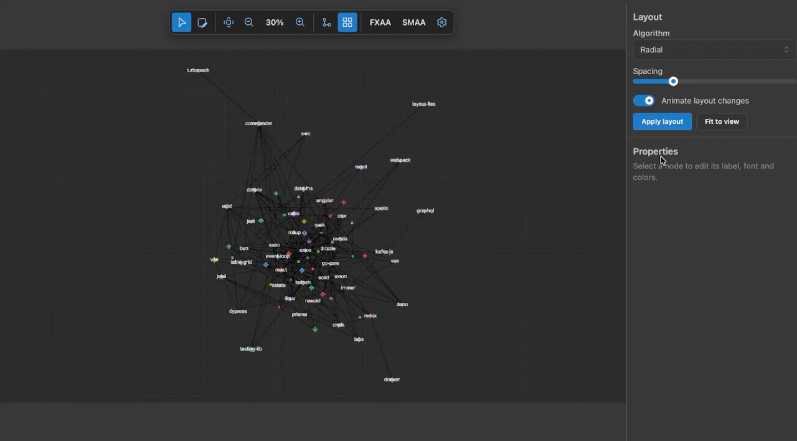

# WebGPU Flow

A node-and-edge diagram editor whose canvas is drawn entirely on the GPU. Shapes, edges, arrowheads, labels and the grid are rendered with WebGPU shaders instead of DOM elements or SVG, so the editor works on the GPU the way a game engine does.

   



Most web diagram tools (React Flow, JointJS, draw.io) build the canvas from HTML or SVG elements. That's easy to style, but each node and edge is a DOM element the browser has to lay out and paint. WebGPU Flow skips that layer: each node is one instance in a single instanced draw call, its shape is an anti-aliased signed distance function, and text comes from a glyph atlas.

The demo opens on a dependency graph of the JavaScript ecosystem (77 nodes, 185 edges) that you can pan, zoom, rearrange and auto-lay-out.

## What's in it

### Rendering
- **Hand-written WebGPU pipeline**: raw WebGPU API and WGSL shaders with no rendering library. Nodes are instanced, edges and labels are batched, and depth layers are explicit.
- **SDF shapes** with smooth edges at any zoom: rectangle, rounded rectangle, circle, oval, diamond, hexagon, package, UML initial/final nodes and actor.
- **SVG and emoji nodes.** Pass an SVG string or emoji as `visualContent` and it's rasterised into a texture atlas. SVGs can be tinted on the GPU.
- **Outline detection on the GPU.** For SVG nodes, a compute shader marches the rendered image to find its real silhouette, so edges attach to the drawn outline, not the bounding box.
- **Readable labels at every zoom.** Text tracks the content but stays within a legible on-screen size, and overlapping labels are dropped by priority (selected first, then most-connected).
- **Anti-aliasing:** MSAA, FXAA, SMAA, and supersampling based on what your GPU supports. Render resolution can be set separately from on-screen size.

### Edges
- **Floating edges** that attach wherever the line meets the shape's border, recomputed as nodes move.
- **User-placed bend points** you can add, drag and delete.
- **20 marker types**, covering the notations people actually use: UML (association, inheritance, realization, aggregation/composition diamonds), ER crow's-foot (one, many, optional, mandatory), plus arrows, bars, dots and squares.
- **Edge labels**, decluttered alongside node labels.

### Layout
- **Automatic layout via [ELK](https://eclipse.dev/elk/):** layered (hierarchical), tree, radial, stress, force and box.
- **Orthogonal, polyline or straight edge routing**, with adjustable direction and spacing. Results are framed to fit the view.
- **Animated transitions.** Nodes travel to their new positions in a wave that follows the layout's direction. On by default, off by default when the OS asks for reduced motion.

### Interaction
- Select, drag and resize nodes. Handles adapt to the shape and hide when a node is too small on screen to grab.
- Grid snapping, with **Alt** to bypass it while dragging.
- Zoom about the cursor, with smooth fit-to-content and zoom animations.
- Edit a node's label, font, colour and icon colour in the properties panel.
- Quadtree spatial index for hit-testing.

### Touch and mobile
- Mouse, touch and pen share one input path. Pinch zooms and pans together, and lifting one finger carries on panning.
- Drag thresholds sized for fingers, so taps aren't mistaken for drags.
- Phone layout: full-screen canvas, compact toolbar, and properties in a bottom sheet.

## Status

This is a working engine and editor, not yet a finished product. Here's where it stands:

- **Browser support.** WebGPU is required and there's no Canvas/WebGL fallback. It runs in current Chrome, Edge and Safari; Firefox support depends on version and platform ([status](https://github.com/gpuweb/gpuweb/wiki/Implementation-Status)).
- **No viewport culling yet.** Every node is drawn every frame. Culling is disabled because hiding an off-screen node also hid edges that still had one end on screen.
- **Missing editor basics:** undo/redo, multi-select, copy/paste, and saving or loading diagrams.
- **Not published as a package.** You can use it inside this repo (see below), but there's no npm release or stable API yet.

## Getting started

Requires Node.js 18+ and a WebGPU-capable browser.

```bash
git clone https://github.com/javapak/webgpu-flow.git
cd webgpu-flow
npm install
npm run dev        # http://localhost:5173
```

`npm run build` produces a static site in `dist/` that can be deployed anywhere, e.g. Vercel, Netlify or GitHub Pages.

## Controls

| Action | Mouse / keyboard | Touch |
| --- | --- | --- |
| Select | Click | Tap |
| Move node / pan | Drag | Drag |
| Zoom | Wheel, `+` / `-`, `0` for 100% | Pinch |
| Fit graph to view | `F` | Toolbar |
| Draw edge mode | `E` (toolbar) | Toolbar |
| Select mode | `V` | Toolbar |
| Auto layout | `L` | Toolbar |
| Toggle grid snap | `G` (hold `Alt` to bypass while dragging) | Toolbar |
| Delete selection or bend point | `Delete` / `Backspace` | — |
| Cancel | `Esc` | — |

## Using the components

Diagrams are built from `<Node>` and `<Edge>` elements inside a `DiagramProvider`. The renderer is a shared instance that has to be initialised once before rendering; see `src/main.tsx`.

```tsx
import { DiagramProvider } from './components/DiagramProvider';
import { DiagramCanvas } from './components/DiagramCanvas';
import { Node } from './components/Node';
import { Edge } from './components/Edge';

<DiagramProvider>
  <DiagramCanvas
    width={800}
    height={600}
    resolution={{ width: 1600, height: 1200 }}
    setSupportedSampleCount={() => {}}
  />

  <Node id="a" type="process" position={{ x: 0, y: 0 }}
        data={{ label: 'Start' }}
        visual={{ shape: 'rectangle', color: '#3b82f6', size: { width: 120, height: 60 } }} />

  <Node id="b" type="process" position={{ x: 260, y: 0 }}
        data={{ label: 'End' }}
        visual={{ shape: 'circle', color: '#22c55e', size: { width: 80, height: 80 } }} />

  <Edge id="a-b" sourceNodeId="a" targetNodeId="b" userVertices={[]}
        style={{ color: [255, 255, 255, 255], thickness: 2, targetMarker: 'arrow' }} />
</DiagramProvider>
```

### SVG and emoji nodes

Set `shape: 'none'` and pass `visualContent`. Edges attach to the drawn outline.

```tsx
<Node id="db" type="database" position={{ x: 200, y: -100 }}
      data={{ label: 'Database' }}
      visual={{
        shape: 'none',
        size: { width: 96, height: 96 },
        visualContent: { type: 'svg', content: '<svg ...>...</svg>', size: { width: 96, height: 96 } },
      }} />

<Node id="launch" type="event" position={{ x: -200, y: -100 }}
      data={{ label: 'Launch' }}
      visual={{ visualContent: { type: 'emoji', content: '🚀', size: { width: 64, height: 64 } } }} />
```

### Adding a shape

Shapes are SDF cases in the node shader in `src/renderers/WebGPURenderer.ts`. Add a distance function, give it a case number, and register the name in `SHAPE_TYPES` at the bottom of the same file. Unknown shapes fall back to a rectangle.

## Project layout

```
src/
├── components/   DiagramProvider (state), DiagramCanvas (input), Toolbar, panels, Node/Edge
├── renderers/    WebGPURenderer, FloatingEdgeRenderer, LabelRenderer, VisualContentRenderer,
│                 FXAA/SMAA/supersampling passes, texture atlases
├── compute/      GPU outline detection for SVG nodes
├── layout/       ELK layout integration and settings store
├── state/        Render settings
├── utils/        Coordinates, spatial index, grid snapping, resize handles, GPU capability probing
└── types/
```

## Roadmap

- [x] SVG node shapes with outline-accurate edge attachment
- [x] Edge markers (UML, ER, arrows)
- [x] Auto-layout
- [ ] Viewport culling that keeps edges visible
- [ ] Undo/redo
- [ ] Multi-select
- [ ] JSON import/export
- [ ] npm package with a stable API
- [ ] Minimap and alignment guides
- [ ] Light theme

## Contributing

Issues and pull requests are welcome: [github.com/javapak/webgpu-flow/issues](https://github.com/javapak/webgpu-flow/issues). If you'd like to take one of the roadmap items, open an issue first so we can agree on the approach.

## License

MIT

Built with [ELK](https://eclipse.dev/elk/), [Mantine](https://mantine.dev/), [Fluent UI Icons](https://github.com/microsoft/fluentui-system-icons), [Zustand](https://zustand.docs.pmnd.rs/) and [Vite](https://vite.dev/).
